<p align="center">
  
</p>

<h1 align="center">NativeCode</h1>

<p align="center">
  <strong>Linux desktop, terminal and AI coding agents on Android.</strong><br>
  An Alpaquita Linux (glibc, aarch64) guest with a Phosh desktop, GPU drivers, audio and an agent chat UI. No PC required.
</p>

<p align="center">
  
  
  
  
  
</p>

<p align="center">
  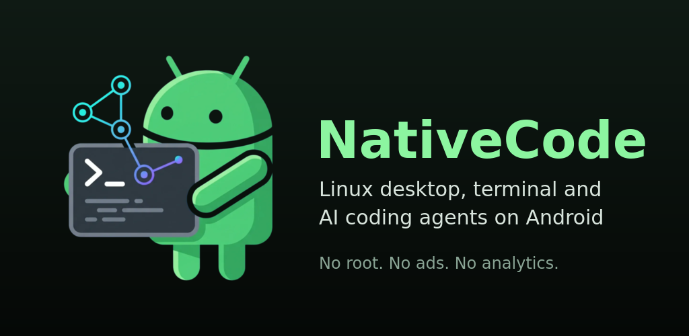
</p>

---

## Contents

- [Screenshots](#screenshots)
- [Features](#features)
- [Play and F-Droid builds](#play-and-f-droid-builds)
- [Requirements](#requirements)
- [First run](#first-run)
- [Architecture](#architecture)
- [Agent bridge](#agent-bridge)
- [Building](#building)
- [Repository layout](#repository-layout)
- [License](#license)
- [Contact](#contact)

## Screenshots

Real device captures (version 1.8.x):

<table>
  <tr>
    <td align="center">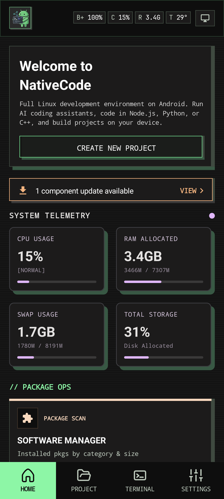<br><sub>Home</sub></td>
    <td align="center">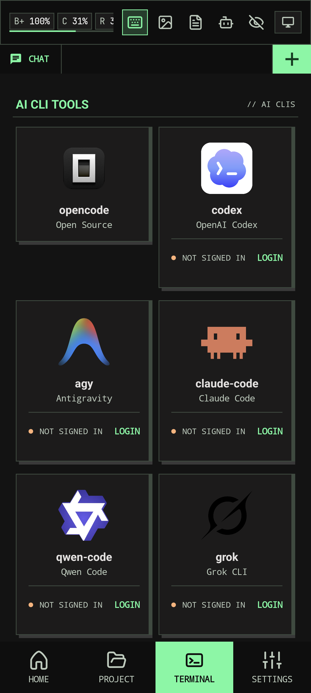<br><sub>AI CLI tools</sub></td>
    <td align="center">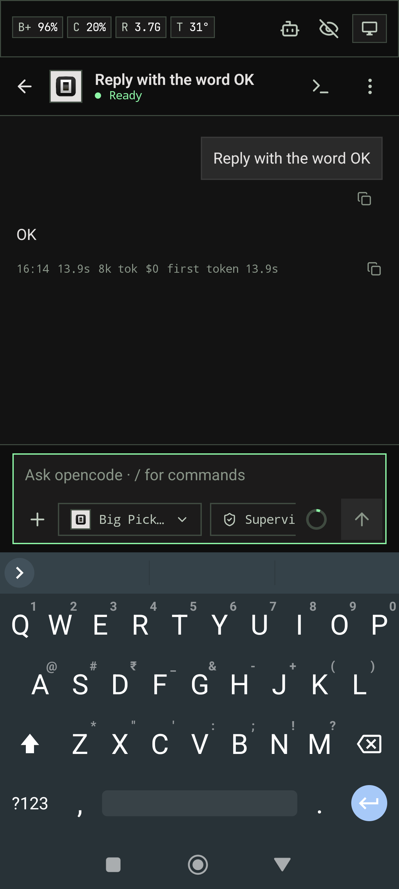<br><sub>Agent chat</sub></td>
    <td align="center">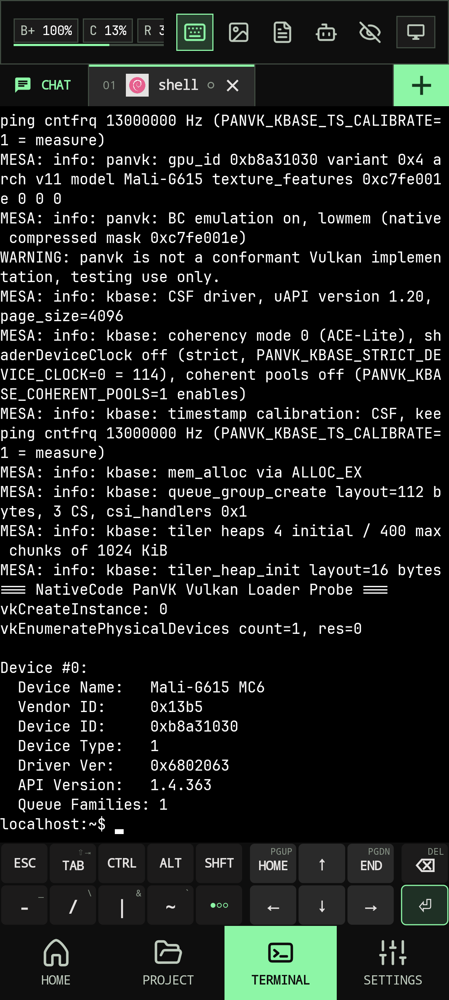<br><sub>Terminal, PanVK probe</sub></td>
  </tr>
  <tr>
    <td align="center">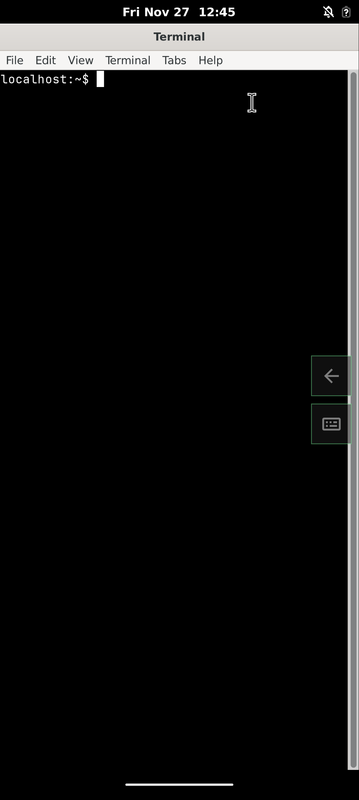<br><sub>Phosh desktop</sub></td>
    <td align="center">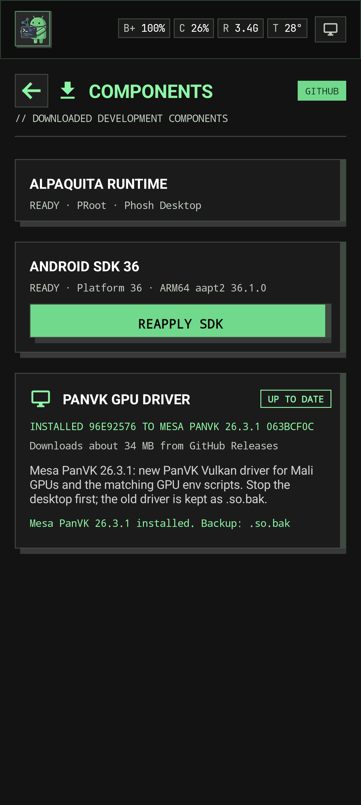<br><sub>Components, GPU driver</sub></td>
    <td align="center">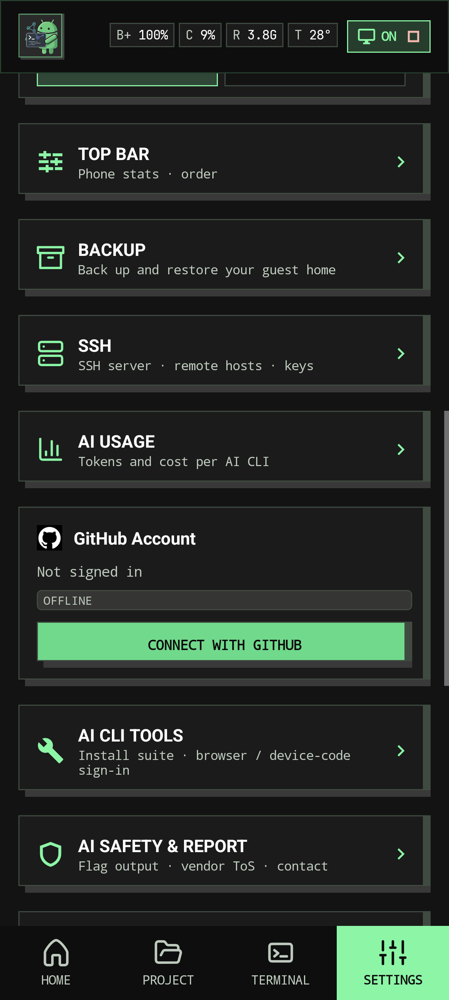<br><sub>Settings</sub></td>
    <td></td>
  </tr>
</table>

Store listing:

<p align="center">
  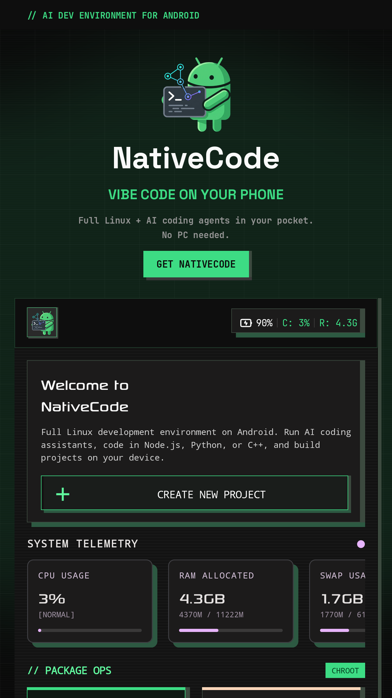
  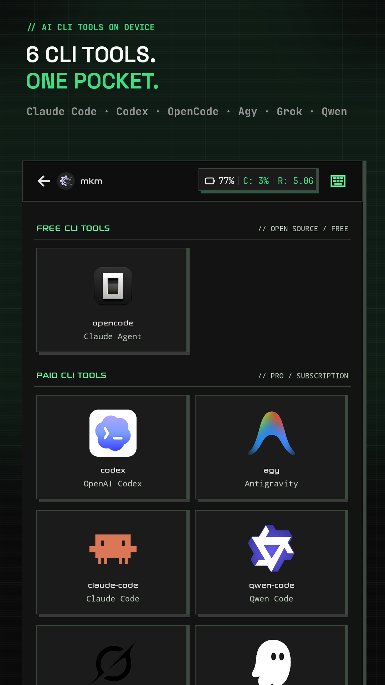
  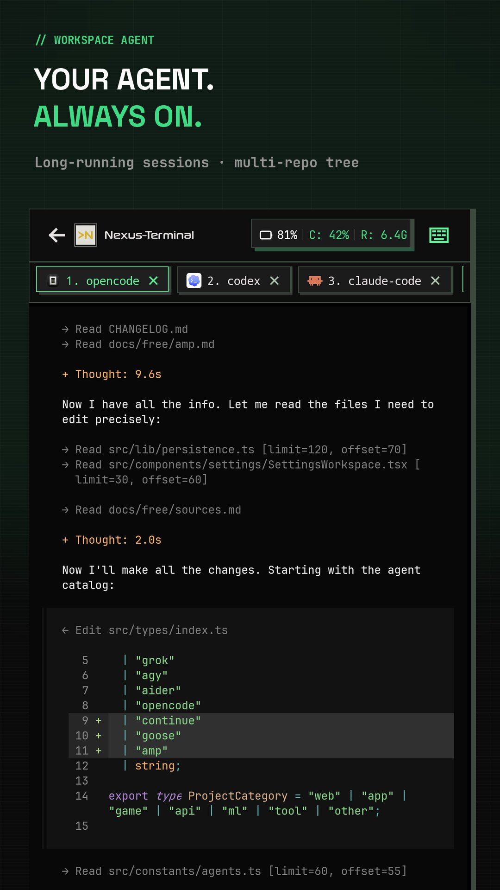
  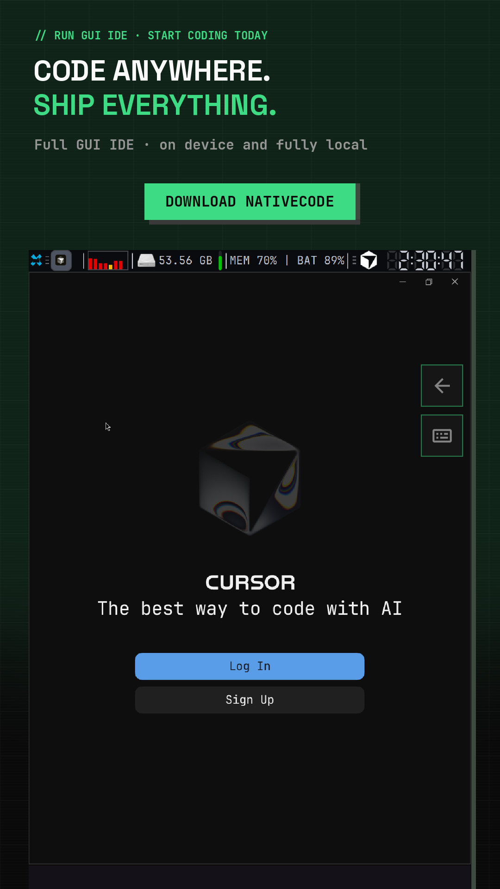
</p>

## Features

**Linux guest**
- Prebuilt **Alpaquita Linux** root filesystem (glibc, aarch64) run under **PRoot**, no root needed.
- **Chroot** mode and a root Linux shell on rooted devices (KernelSU or Magisk `su`). Play build only.
- Custom Termux-based host userland (`bootstrap.tar`) built for the app's own package prefix.
- Runtime update pack on top of the base rootfs (newer AI CLIs, GitHub CLI, OpenSSH, zsh), applied on fresh installs and upgrades, plus an optional Android SDK pack (platform 36, ARM64 `aapt2`) for building Android apps on the device.

**Desktop, graphics and audio**
- **Phosh** (Wayland, phoc) desktop shown through the bundled **Termux-X11** display server.
- Vulkan drivers: **Mesa PanVK 26.3.1** for Mali (kbase), **Mesa Turnip 27.0.0-r2** for Adreno (KGSL), with Zink for OpenGL; Venus fallback on other GPUs. Drivers are updated from the app with the previous `.so` kept as a backup.
- **PulseAudio** sound from the guest to Android.
- **Clipboard sync** both ways between Phosh and Android (wlr-data-control to X11 daemon in the guest, Termux-X11 to Android), with an in-app toggle.

**AI agents**
- AI CLI catalog with guided install and sign-in: **Claude Code**, **OpenAI Codex**, **Qwen Code**, **OpenCode**, **Antigravity**, **Grok** and **Kiro**.
- Native **agent chat UI** on top of the CLIs: Claude Code (stream-json), Codex (app-server), OpenCode (HTTP and SSE), Antigravity and Grok (Agent Client Protocol, ACP). Qwen Code and Kiro run in the terminal.
- Built-in **MCP server** (Streamable HTTP on `127.0.0.1`, per-thread bearer token) that gives agents NativeCode tools: task delegation, cross-thread messages, projects and environment info.
- Agent bridges: the guest CLIs `nativecode-agent` and `nativecode-media` talk to the app over Android abstract sockets (notifications, toasts, status, file sharing, links, APK install, device telemetry, hardware video encode and decode).
- Agent skills catalog, AI usage page (tokens and cost per CLI) and AI safety and report page.

**Workspace**
- Projects with a file tree, code editor, multi-tab terminal with an extra-keys toolbar, Git status, visual diff, log graph and branches, GitHub CLI sign-in.
- Local web preview of guest dev servers.
- **SSH** server in the guest (key auth, port 8022) and saved remote hosts.
- **Backup and restore** of the guest home as `nativecode-backup-<date>.tar.zst`, with exclusion presets and optional credentials.
- **Hardware** page: GPU driver, Vulkan ICD, bridge sockets, host servers and thermal state.
- Software **marketplace** for guest packages (Play build only).
- Home-screen **widget** (2x1: Agent and Desktop) and a Quick Settings tile for the desktop.
- 13 UI languages.

## Play and F-Droid builds

One codebase, two product flavors (`app/build.gradle.kts`):

| | `play` | `fdroid` |
|---|---|---|
| Application ID | `com.zenithblue.nativecode` | `com.zenithblue.nativecode.fdroid` |
| Linux runtime packs | Play Asset Delivery (on-demand packs `nativecode_runtime`, `nativecode_update_core`, `nativecode_android_dev`) | Downloaded from GitHub Releases after explicit consent |
| Host bootstrap and native libs | Bundled | Built from source (`tools/fdroid/`) |
| GPU drivers | Bundled in app assets | Downloaded, size and SHA-256 pinned |
| PRoot | Yes | Yes |
| Chroot, root shell, marketplace | Yes | No |
| Billing | Google Play Billing (free tier plus Pro) | None, every feature on |
| Telemetry | Firebase, off until the user opts in | None |

The F-Droid build downloads its packs from
[`zenithblue-oss/nativecode-runtime`](https://github.com/zenithblue-oss/nativecode-runtime) release `runtime-1.8.0`.
Each file is accepted only when its size and SHA-256 match `app/src/fdroid/java/com/zenithblue/nativecode/onboarding/ReleasePins.kt`.
Asset list: [`tools/fdroid/RELEASE_ASSETS.md`](tools/fdroid/RELEASE_ASSETS.md).

> **Third-party software in the downloaded packs.** The root filesystem and runtime update pack ship proprietary AI CLIs pre-installed (Claude Code, Antigravity, Grok, Kiro), and the Android SDK pack contains Google's Android SDK components. Each is under its vendor's own license and is not part of this app's source code. The AI CLIs talk to their vendors' online services when you sign in and use them.

## Requirements

- Android 8.0+ (minSdk 26), target SDK 37, **arm64-v8a** only.
- More than **10 GB** free internal storage (hard requirement in the device check).
- Recommended: more than 7000 MB RAM and more than 7000 MB swap (soft warnings).
- Root (KernelSU or Magisk) only for chroot mode in the Play build.

## First run

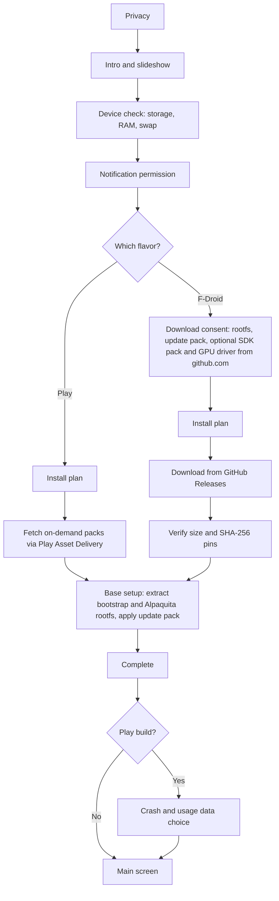

## Architecture

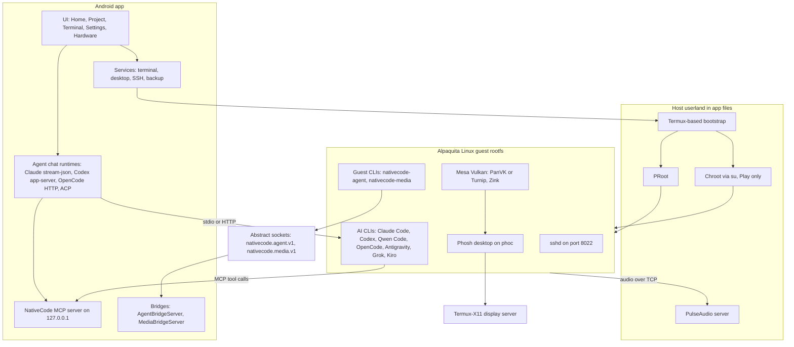

The app copies its host userland to internal storage, then starts the guest through PRoot (or chroot on rooted Play installs).
`nativecode_bridge.json` in the guest `/run` tells the guest CLIs which socket names to use: Play and F-Droid builds share the abstract namespace, so the second installed build binds `@nativecode.*.v1.<uid>`.

## Agent bridge

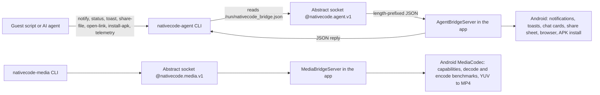

Agent bridge control frames are capped at 64 KiB, and notifications, toasts, alerts and file shares are rate-limited.

## Building

Requirements: JDK 17+ and the Android SDK with platform 37. The F-Droid native scripts also need the Termux package build dependencies listed in the recipe below.

```bash
# F-Droid flavor (needs the source-built bootstrap and native libs first, see tools/fdroid/)
tools/fdroid/build_native.sh --install
tools/fdroid/build_bootstrap.sh --install
tools/fdroid/build_xlorie.sh --install
./gradlew :app:assembleFdroidDebug

# Play flavor
./gradlew :app:assemblePlayDebug
./gradlew :app:bundlePlayRelease   # AAB with the asset packs
```

Notes:
- The Play flavor expects the large pack files (`alpaquita_rootfs.tar.zst`, `nativecode_update.tgz`, `nativecode_android_dev.tar.xz`) in the asset-pack modules and, for Firebase, `app/src/play/google-services.json`. None of these are in the repository; only their `.sha256` files are.
- Release signing reads `key.properties` or the `RELEASE_KEYSTORE_*` environment variables.
- The F-Droid build recipe draft is `tools/fdroid/com.zenithblue.nativecode.fdroid.yml`; the pinned source versions are in `tools/fdroid/pins.env`.

## Repository layout

```
app/                     Android app (Kotlin, Android Views)
  src/main/              Shared code, assets (guest CLIs, skills, scripts)
  src/play/              Play flavor: Play Asset Delivery, billing, Firebase, bundled GPU drivers
  src/fdroid/            F-Droid flavor: release downloader, pins
nativecode_runtime/      Play asset pack: Alpaquita rootfs
nativecode_update_core/  Play asset pack: runtime update pack
nativecode_android_dev/  Play asset pack: Android SDK pack
termux-x11/              Bundled Termux-X11 display server
termux-app/              Termux libraries (terminal emulator, shared)
tools/fdroid/            F-Droid source build scripts, recipe, release asset list
fastlane/                Store metadata and screenshots (13 locales)
docs/                    Plans, policies, privacy policy
```

## License

GPL-3.0-or-later for this app's source. Bundled and downloaded third-party components keep their own licenses: Termux and Termux-X11 (GPL-3.0), PRoot (GPL-2.0-or-later), Mesa PanVK and Turnip (MIT), the Alpaquita Linux packages, and the proprietary AI CLIs and Google Android SDK noted above. The in-app open source licenses screen lists the bundled libraries.
Privacy policy: [`docs/privacy-policy.md`](docs/privacy-policy.md).

## Contact

Developer: **ZenithBlue**, [zenithblue.dev@gmail.com](mailto:zenithblue.dev@gmail.com)
Source: [github.com/zenithblue-oss/nativecode](https://github.com/zenithblue-oss/nativecode) · Runtime packs: [github.com/zenithblue-oss/nativecode-runtime](https://github.com/zenithblue-oss/nativecode-runtime)
